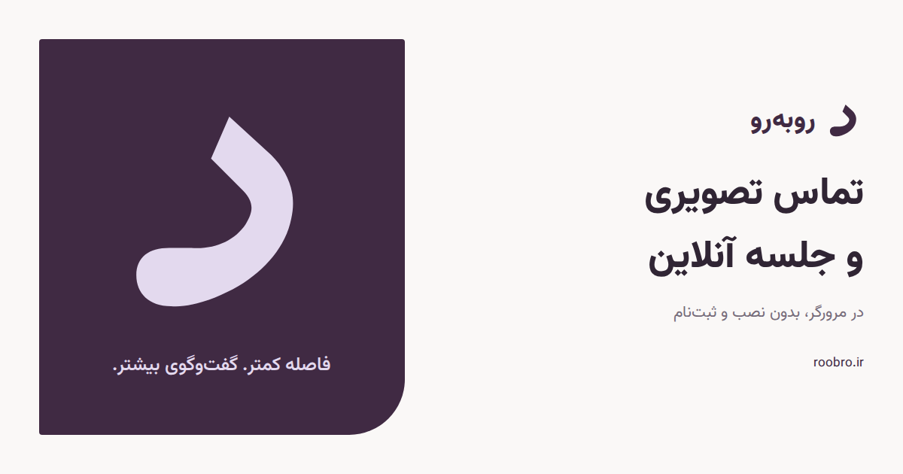

# رو به رو

<p align="center">
  <picture>
    <source media="(prefers-color-scheme: dark)" srcset="frontend/public/logo-light.svg" />
    
  </picture>
</p>

<p align="center">
  A Persian video-meeting experience designed for natural, focused conversations.
</p>

<p align="center">
  <a href="https://roobro.ir">Website</a> ·
  <a href="docs/deployment.md">Deployment guide</a> ·
  <a href="docs/architecture.md">Architecture and limits</a>
</p>



Browser-based video meetings you join with a short share code. The interface is
Persian and RTL, media runs on LiveKit, and credentials stay behind a Go API. A
built-in demo mode lets you explore the full flow without any infrastructure.

## Features

- Short share codes and links, with a camera/mic preview before joining
- Video, audio, screen sharing, chat, and host controls
- Watch or listen together: everyone plays their own copy of a file in sync,
  and nothing is uploaded ([how it works](docs/architecture.md#watch-and-listen-together))
- Connection diagnostics: ping, jitter, packet loss, and per-stream stats
- Responsive layout for desktop and mobile

**Stack:** React 19, TanStack Router, Vite, Tailwind CSS 4, i18next · Go, Gin · LiveKit · Bun, Docker Compose

## Quick start

Requires [Bun](https://bun.sh/), [Go](https://go.dev/) 1.27+, and [Docker](https://www.docker.com/) with Compose.

```bash
git clone https://github.com/4H1R/roobro.git
cd roobro
make install
make up        # Go API + LiveKit
make frontend  # in a second terminal
```

Open [localhost:3000](http://localhost:3000). Development defaults live in
`docker-compose.yml`; copy `.env.example` to `.env` only to override them.

```bash
make test        # backend tests, frontend type-check, and frontend tests
make front-build # production frontend build
make logs        # follow container logs
make down        # stop the stack
```

## Deploy

On a Linux server with Docker Compose v2:

```bash
curl -fsSL https://raw.githubusercontent.com/4H1R/roobro/main/deploy/install.sh | sudo sh
```

This installs to `/opt/roobro` and starts an HTTP deployment so you can check
the stack works. Browsers only allow camera and mic access over HTTPS, so follow
the [deployment guide](docs/deployment.md) to attach a domain and TLS.

## API

| Method | Endpoint | Description |
| --- | --- | --- |
| `POST` | `/api/v1/meetings` | Create a meeting |
| `GET` | `/api/v1/meetings/:code` | Get meeting details |
| `POST` | `/api/v1/meetings/:code/join` | Join and receive a LiveKit token |
| `POST` | `/api/v1/meetings/:code/end` | End a meeting as its host |
| `POST` | `/api/v1/livekit/webhook` | Receive signed LiveKit room events |
| `GET` | `/health` | Health check |

Meetings are stored in memory, so restarting the API clears them. See
[architecture and limits](docs/architecture.md) for retention and rate limits.

## Repository layout

| Path | Purpose |
| --- | --- |
| `cmd/api/` | Go API entry point |
| `internal/` | Meeting domain, service, HTTP, and LiveKit integration |
| `frontend/` | React/Vite application and tests |
| `deploy/` | Installer and Caddy configuration |
| `docs/` | Deployment and architecture docs |

## Contributing

Issues and pull requests are welcome. Run `make test` and `make front-build`
before submitting a change.

## License

[MIT](LICENSE)
